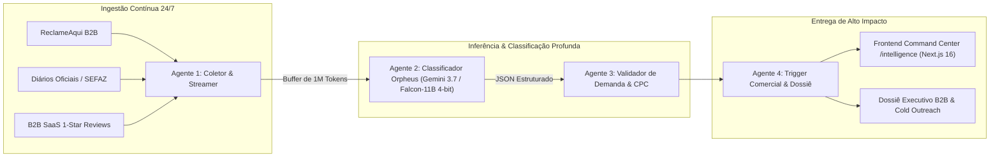

<div align="center">

# Victor Borsari — AI Systems Engineering & Autonomous Intelligence Platform

### Architecting Autonomous Agent Networks (A2A), LLM Quantization & Real-Time Market Friction Engines

[](https://nextjs.org/)
[](https://react.dev/)
[](https://www.typescriptlang.org/)
[](https://tailwindcss.com/)
[](https://threejs.org/)
[](https://python.org/)

[](https://github.com/Victor-Enginner)
[](http://localhost:3001/intelligence)

---


</div>

---

## 🏛️ Executive Summary

This platform is a high-performance **AI Engineering Command Center & Autonomous Agent Ecosystem** engineered by **Victor Borsari**. 

Beyond traditional static portfolios, it integrates a full **Agent-to-Agent (A2A) Financial Friction & Market Opportunity Miner (Orpheus Engine)** that continuously scans non-synthetic unstructured data (Diários Oficiais, SEFAZ tax gazettes, B2B SaaS 1-star reviews, enterprise support forums) to identify, score, and monetize real-world corporate inefficiencies and compliance risks.

---

## ⚡ Core Capabilities & Architecture



### 1. Pain Scraper & Market Miner (`/intelligence`)
- **Scoring Determinístico (0.0 a 10.0)**: Avalia perda financeira direta, multas regulatórias e ineficiência operacional em horas.
- **Estimativa de Prejuízo em Dólares ($/mês)**: Calcula o ROI imediato de cada solução de engenharia.
- **Auto-Sync via Webhook**: Sincronização em tempo real entre o coletor Python assíncrono e a interface Next.js.
- **Gerador de Dossiê Executivo & Cold Outreach**: Produz diagnósticos de conformidade e e-mails de abordagem para tomadores de decisão (CFO, CTO, Head de Operações).

### 2. Engenharia de IA & Inferência Otimizada
- **Quantização 4-Bit NF4 (BitsAndBytes)**: Modelos como Falcon-11B otimizados para rodar em GPUs com apenas 6GB de VRAM (< $2/dia na Vast.ai).
- **Buffer de 1M de Tokens**: Ingestão de editais e centenas de reclamações em passada única sem perda de contexto.
- **Dual-Provider AI Chatbot**: Assistente conversacional embarcado operando 24/7 para qualificação de clientes e demonstração técnica.

### 3. Frontend de Alto Impacto (Next.js 16 + WebGL)
- **Three.js & React Three Fiber (R3F)**: Simulações interativas de física e visualizações 3D de fluxo de agentes.
- **Custom Shaders & Framer Motion**: Estética terminal/cyber com telemetria ao vivo dos agentes autônomos.

---

## 🛠️ Stack Tecnológica

| Camada | Tecnologias |
|---|---|
| **Frontend & UI** | Next.js 16 (App Router, Turbopack), React 19, TypeScript, Tailwind CSS, Shadcn UI |
| **3D & Shaders** | Three.js, React Three Fiber, Rapier Physics, Custom GLSL Shaders, Framer Motion, GSAP |
| **Agentes & Orquestração** | Python 3.11, Antigravity CLI, Continue.dev, BeautifulSoup4, Playwright |
| **Modelos de IA** | Gemini 3.7 Flash (1M Context), Falcon-11B 4-bit NF4, DeepSeek-Coder, Groq |
| **Infraestrutura** | Docker, Docker Compose, Vast.ai GPU Instances, Pnpm v11 |

---

## 🚀 Como Executar

### 1. Clonar o Repositório
```bash
git clone https://github.com/Victor-Enginner/intelligence.git
cd intelligence
```

### 2. Instalar Dependências e Iniciar o Frontend
```bash
pnpm install --ignore-scripts
pnpm run dev
```
Acesse a Dashboard em: **`http://localhost:3001/intelligence`**

### 3. Rodar o Orquestrador de Coleta A2A (Python)
```bash
python scraper_orchestrator.py --daemon
```

---

## 📄 Licença

Este projeto está licenciado sob a licença [MIT](LICENSE).

<div align="center">
  <p><strong>Projetado e Desenvolvido por Victor Borsari</strong> — Engenheiro de IA & Arquiteto de Sistemas</p>
</div>
