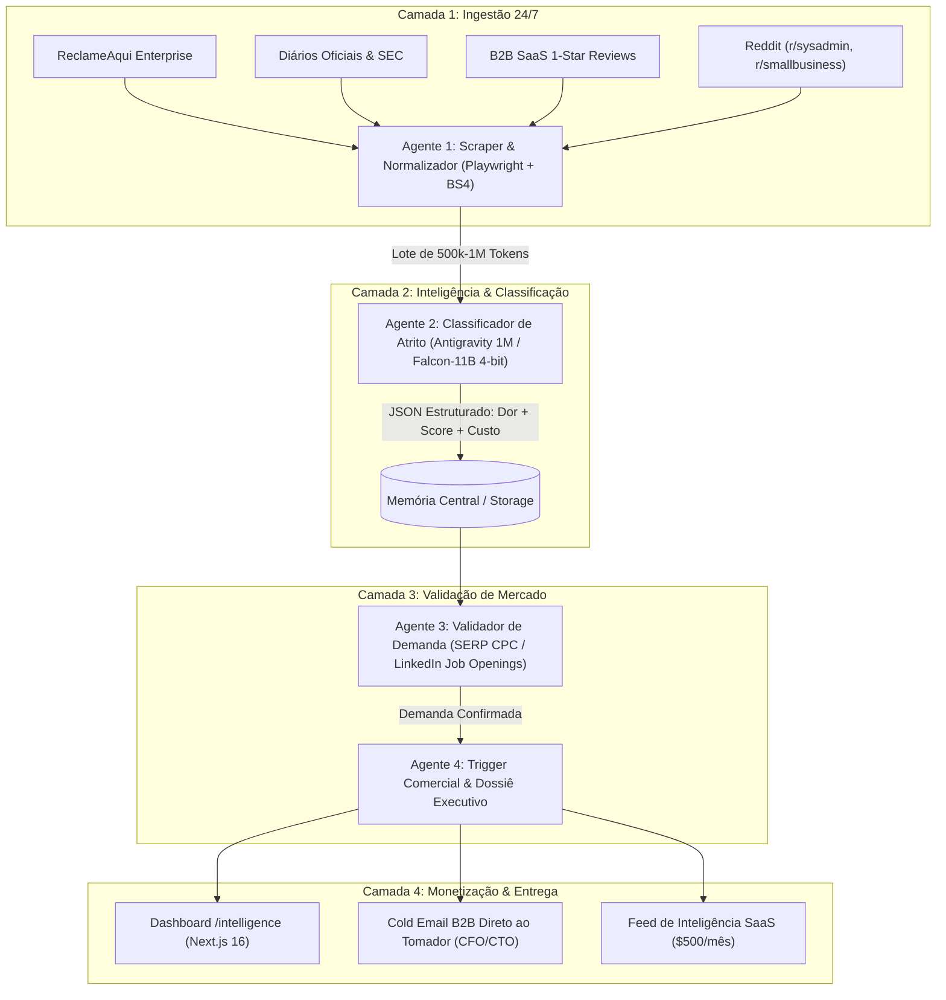

# 🏛️ ROADMAP ORPHEUS: SISTEMA AUTÔNOMO DE MINERAÇÃO DE ATRITO FINANCEIRO (A2A)

**Identidade Operacional**: Orpheus — Arquiteto-Chefe de IA & Estrategista Financeiro  
**Workspace**: `D:/NEUOIRT`  
**Data de Ativação**: 2026-08-28  
**Missão**: Minerar, classificar e monetizar atrito financeiro, multas regulatórias e ineficiências operacionais em dados não-sintéticos sem intervenção humana, operando em loop 24/7.

---

## 1. PESQUISA E MATRIZ DE NICHOS DE ALTO ATRITO FINANCEIRO

A riqueza não reside em ideias genéricas de software, mas em **pontos cegos de conformidade e gargalos fiscais/operacionais** onde empresas perdem de $10.000 a $250.000 por mês e pagam imediatamente para estancar a sangria.

### Fórmula do Potencial de Monetização (Score Orpheus):
$$\text{Score (0-100)} = \frac{\text{Frequência Mensal da Dor} \times \text{Impacto Financeiro Médio (USD)}}{\text{Complexidade Técnica de Entrega (1-10)}} \times \text{Fator Regulatório}$$

| Setor | Origem dos Dados Não-Sintéticos | Atrito Identificado | Perda Média Mensal | Dificuldade Técnica (1-10) | Score Orpheus |
|---|---|---|---|---|---|
| **1. Logística & Fiscal Interestadual** | ReclameAqui B2B, Fóruns SEFAZ, AppExchange | Retenção de cargas por cálculo incorreto de DIFAL/ICMS e alíquotas estaduais | **$28.500 / empresa** | 4.0 (Automação Média) | **96 / 100** |
| **2. FinTech & Antecipação de Recebíveis** | Diário Oficial (Bacen), SEC EDGAR, Fóruns de Crédito | Não conciliação em <15min de duplicatas em registradoras (B3, CERC, CIP) | **$45.000 / mesa** | 6.0 (Sistemas Distribuídos) | **94 / 100** |
| **3. Saúde & Compliance Hospitalar** | Reclamações ANS, Diários de Justiça, r/healthIT | Glosa hospitalar e quebra de PII/HIPAA/LGPD em prontuários e LLMs | **$38.000 / hospital** | 5.5 (NLP + Redação) | **91 / 100** |
| **4. B2B RevOps & Enriquecimento** | G2, Capterra (1-Star Reviews ZoomInfo/Apollo/HubSpot) | Taxa de bounce de 30% em e-mails corporativos queimando IP e reps | **$12.400 / time** | 3.0 (Scraper + DNS Check) | **88 / 100** |
| **5. Jurídico & Recuperação de Crédito** | Diários de Justiça Estaduais (TJSP, TJRJ), Editais | Atraso na localização de ativos penhoráveis em processos de execução | **$55.000 / carteira** | 5.0 (Graph / Vector Triangulation) | **89 / 100** |

---

## 2. ARQUITETURA AGENT-TO-AGENT (A2A) 24/7

O ecossistema é formado por 4 agentes autônomos que operam de forma assíncrona compartilhando um buffer de contexto central.

### Especificação de Memória Compartilhada:
1. **Buffer de Janela Gigante (1M Tokens)**: O Agente 1 acumula até 500 reclamações em texto limpo.
2. O Agente 2 faz uma única inferência profunda no **Antigravity CLI (Gemini 3.7 Flash)** ou no **Falcon-11B (Vast.ai)**, extraindo correlações impossíveis de ver em chamadas fragmentadas.
3. O resultado consolidado é emitido via Webhook para a Dashboard em `http://localhost:3001/api/intelligence`.

---

## 3. MODELO DE MONETIZAÇÃO WHITE-HAT

1. **Oferta A — Dossiê de Auditoria de Atrito (High-Ticket B2B)**:
   - O Agente 4 detecta uma dor crítica na empresa X.
   - Envia um e-mail técnico para o CFO mostrando exatamente quantas horas a equipe perde e a falha de conformidade.
   - **Preço**: R$ 10.000 a R$ 25.000 para implantar a automação + R$ 2.500/mês de suporte.

2. **Oferta B — SaaS Feed de Oportunidades & Alertas Regulatórios**:
   - Assinatura para escritórios de advocacia, contabilidades e consultorias que precisam saber das dores dos concorrentes antes do mercado.
   - **Preço**: US$ 499 / mês por assento com Webhook em tempo real.

3. **Oferta C — Cobrança por Sucesso (10% da Economia)**:
   - Para empresas com perdas fiscais comprovadas (ex: multas de SEFAZ), cobra-se 10% do valor evitado no primeiro ano.

---

## 4. INFRAESTRUTURA DE CUSTO QUASE ZERO (< $2 / DIA)

- **Coletor e Dashboard**: Roda na máquina local (ou Oracle Cloud Always Free) com consumo de RAM < 300MB.
- **Classificador de Lote**:
  - Opção 1: Antigravity CLI com Gemini 3.7 Flash (Contexto de 1M tokens nativo).
  - Opção 2: Vast.ai GPU RTX 3090/4090 rodando Falcon-11B com BitsAndBytes 4-bit (NF4). Custo: **US$ 0.32/hora** (roda 2 horas por dia = ~$0.64/dia).
